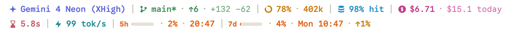

<div align="center">

# AGY Statusline

[简体中文](README.md) | [English](README.en.md)

**A native Rust statusline & telemetry plugin for Google Antigravity 2.x Desktop (macOS / Windows)**

Live in-page statusline · Usage analytics & per-call drill-down · 8 light/dark themes · Optional Chinese UI · Verified self-updates

[](https://github.com/BlueOcean223/agy-statusline/releases/latest)
[](LICENSE)


<br>



</div>

> [!NOTE]
> Unofficial third-party plugin. All telemetry is read locally from Antigravity's `language_server` and local files — **no outgoing requests to Google are intercepted or modified**. Visual design inspired by [agy-zh-pack](https://github.com/ncdeng/agy-zh-pack) and [CCometixLine](https://github.com/Haleclipse/CCometixLine).

---

## Highlights

- **Lightweight Native Rust Sidecar**: Single binary reading local read-only APIs with hook-driven wakeups — **no `fetch` monkey-patching and no window reload required**; automatically reloads stuck `"plugin unavailable"` side panels.
- **In-Page Statusline**: Two compact lines above the chat input showing model, Git workspace status (branch, dirty state, ahead/behind, line diffs), context usage & compaction badge, prompt cache hit rate & miss-cause tooltips, conversation/daily API-equivalent cost (including `agy CLI` spend and configurable costly-call `⚡` alert), TTFT, streaming speed, 5h/7d quota bars & pace, plus column-aligned subagent tree rows.
- **Five-Tab Auxiliary Pane (`AUX_PANE`)**: Sticky live statusline preview at the top with **Overview / Turns / Usage / Theme / Settings** tabs below, including an on-demand context compaction checkpoint viewer.
- **Usage Dashboard & History Backfill**: 7 / 30 / All-time (up to 400 days, automatically weekly-bucketed beyond 62 days) stacked model cost charts, unified Desktop + `agy CLI` spend tracking, 6-cause cache-miss analysis, per-day **Calls / By Conversation** drill-down (with source/model/miss filters & pagination), and per-account weekly quota period segmentation, early-reset detection (`↺`), cycle-start capacity (`cap ≈`), and past-cycle history.
- **Layered Appearance Customization**: 8 light/dark palettes (rendered as live mini-bar cards in the `Theme` tab), 3 shapes, 4 quota meters, `compact` / `full` density, and 4 inline icon styles (zero external font downloads).
- **Optional Chinese UI**: Bundles [agy-zh-pack](https://github.com/ncdeng/agy-zh-pack)'s dictionary & translator v12 with main-window + Swarm panel translation, **instant on/off switching** (restores original English without reloading), temporary English hotkey (`Ctrl+Option+E` on macOS / `Ctrl+Alt+E` on Windows, synced across windows & Swarm), and hover-for-English error tooltips.
- **Cross-Platform Relaunch & Self-Updater**: macOS & Windows debug-port relaunch with main-process flag checks to prevent false restarts; built-in GitHub Releases updater with `SHA256SUMS` verification & rollback, plus optional online sync of dictionary and official pricing data.

---

## Installation

Download the archive for your platform from [Releases](https://github.com/BlueOcean223/agy-statusline/releases/latest) and extract the `agy-statusline/` folder into Antigravity's plugins directory. Antigravity loads it automatically:

| Platform | Package | Plugin Directory |
|---|---|---|
| **macOS** (Apple Silicon & Intel Universal) | `agy-statusline-v<version>-macos-universal.tar.gz` | `~/.gemini/config/plugins/agy-statusline` |
| **Windows** (x64) | `agy-statusline-v<version>-windows-x64.zip` | `%USERPROFILE%\.gemini\config\plugins\agy-statusline` |

> **macOS note**: The binary is unsigned. If downloaded via a browser, clear the quarantine attribute so Gatekeeper won't block it:
> ```bash
> xattr -dr com.apple.quarantine ~/.gemini/config/plugins/agy-statusline
> ```

Checksums are published in `SHA256SUMS`. Once installed, open **Statusline** from Antigravity's top-right Plugins menu. Future releases can be installed in one click from **Settings → Update Center**.

---

## Enabling the In-Page Statusline & Chinese UI

Starting with Antigravity 2.33.0, injecting scripts into the main window over CDP requires launching Antigravity with `--remote-debugging-port=0`. (Without this flag, the side pane still works normally.)

- **Easiest way**: Open the side pane's **Settings** tab and click **Restart Antigravity in Debug Mode** (two-click confirmation; supported on both macOS and Windows).
- **Optional auto-handling**: Under **When launched without a debug port**, choose `Never (default)`, `Ask`, or `Auto relaunch`. Before acting, the sidecar checks the running main process command line to confirm the flag is genuinely absent, avoiding restarts when the port is merely busy.
- **Manual launch**:
  ```bash
  # macOS
  open -a Antigravity --args --remote-debugging-port=0
  ```
  ```powershell
  # Windows
  & "$env:LOCALAPPDATA\Programs\antigravity\Antigravity.exe" --remote-debugging-port=0
  ```

`0` binds a random loopback port; the sidecar detects it every 3 seconds and injects automatically without reloading the window.

> [!WARNING]
> Launching with `--remote-debugging-port` exposes a local Chromium debugging port on `127.0.0.1` accessible to other local processes. If you prefer not to expose it, keep running Antigravity normally and use the auxiliary side pane only.

---

## Features Overview

### In-Page Statusline

Every segment includes a custom hover tooltip (unaffected by live redraws) and can be toggled individually in **Settings** (12 toggles):

| Row | Segments | Details |
|---|---|---|
| **Line 1** | Model · Git · Context · Cache · Cost · Running | Highlights mismatched API `responseModel` in warning color; Git displays branch, dirty `*`, upstream ahead/behind, and `+/-` line diff vs. `HEAD`; Context uses a dynamic SVG ring gauge and compact `↻N×` compaction pill; Cache tooltips show recent miss causes; single calls over the costly threshold (default `$0.50`) show a `⚡` alert badge, and Cost tooltips include today's `agy CLI` spend; `running` reserves layout space when idle to prevent line jumps |
| **Line 2** | TTFT · Speed · `5h` Quota · `7d` Quota | Configurable quota meters (`thin`, `cells`, `ring`, `none`); `7d` displays pace delta vs. an even weekly burn (`↑` ahead / `↓` under pace) |
| **Subagents** | `├` / `└` Aligned Tree Rows | Lists active and recently finished (10s) subagents with aligned columns for role, model, context, cache, own cost, and status (`● elapsed`, `● waiting` for approval, or `✓ done duration · N steps`); hover reveals the current action and last 5 steps |

### Sidecar Auxiliary Pane (5 Tabs)

| Tab | What's Inside |
|---|---|
| **Overview** | Context meter, trend sparkline, estimated turns left & clickable compaction checkpoint viewer; prompt cache hit rate, warmth TTL countdown, savings & miss breakdown; token/cost breakdown (including Claude cache writes); speed/TTFT sparkline; dual-bar 5h & 7d quota pace; subagent list with quick-open links |
| **Turns** | Reverse-chronological log of every model call in the conversation (timestamp, context size, cache hit % & miss-cause badges, costly-call highlight, output tokens, cost, TPS, TTFT, action summary, and clickable compaction checkpoints) |
| **Usage** | Today's 4 KPI cards (Desktop + `agy CLI`, with cache-miss waste estimate), 7 / 30 / All-time (up to 400 days, weekly-bucketed >62d) stacked model chart, daily summary table, **click-any-day drill-down** (`Calls` / `By Conversation` tabs, source/model/miss filters & pagination), and per-account weekly quota period segmentation, early-reset markers (`↺`), cycle-start capacity (`cap ≈`), and past-cycle history; backfills historical Desktop + CLI data read-only on first run |
| **Theme** | 8 light/dark palettes (Cometix, Catppuccin, Tokyo Night, Rosé Pine, Gruvbox, Nord, Dracula, Mono) rendered as live mini statusline cards, plus shape (`plain` / `pill` / `powerline`), quota meter (`thin` / `cells` / `ring` / `none`), density (`compact` / `full`), and icon (`solid` / `outline` / `unicode` / `off`) controls |
| **Settings** | Master bar toggle & 12 segment checkboxes, instant Chinese UI toggle & temporary English button/hotkey (`Ctrl+Option+E` / `Ctrl+Alt+E`), costly-call alert threshold, cross-platform debug relaunch policy & button, **Update Center** (verified plugin self-update + online dict/price sync), and calculation settings |

---

## Pricing, Privacy & Network

- **Cost Estimates**: Calculated as `tokens × public API list prices` for reference only — subscriptions bill against quota, not per token. Built-in rules support Claude 5-minute cache writes and scheduled price tiers (Gemini 4 Carbon/Argon on `2026-12-01` and 3.8 Flash on `2027-01-01`), and can be customized under `[[models]]` in `config.toml`.
- **Privacy & Storage Safety**: Only settings, numeric usage aggregates, CLI day index, and quota samples are stored under `plugin_data/agy-statusline/`. Conversation contents and raw emails are never persisted (accounts are keyed by masked email + FNV-1a hash; compaction summaries are read on-demand from local `transcript_full.jsonl` behind UI token auth). All state files use atomic writes and automatically back up unparseable files as `.bad-*` instead of overwriting them.
- **Network Access**: Strictly read-only, proxy-aware (env vars, macOS `scutil --proxy`, Windows registry proxy), and toggleable in **Settings → Update Center**:
  1. Checking/downloading releases and `SHA256SUMS` from this repository's GitHub Releases (installs only on click; refuses to overwrite `.git` dev checkouts);
  2. Optional commit-pinned sync of dictionary, rules, and `data/prices.json` from `ncdeng/agy-zh-pack` via jsDelivr / GitHub raw.

---

## Documentation & Development

- Architecture, data sources, local build & release workflow: [docs/development.en.md](docs/development.en.md)
- Design comparison & data-flow diagram (Chinese): [docs/architecture.html](docs/architecture.html)

---

## Acknowledgements & License

- Statusline visual layout, color themes, and Chinese UI dictionary/translator inspired by or sourced from [agy-zh-pack](https://github.com/ncdeng/agy-zh-pack) and [CCometixLine](https://github.com/Haleclipse/CCometixLine).
- Color palettes adapted from Catppuccin, Tokyo Night, Rosé Pine, Gruvbox, Nord, and Dracula.
- Licensed under **MIT** ([LICENSE](LICENSE)). Files under `i18n/` retain agy-zh-pack's MIT license ([i18n/LICENSE](i18n/LICENSE)). `web/preload.js` is Antigravity's built-in sidecar bridge script and is outside this project's license.
