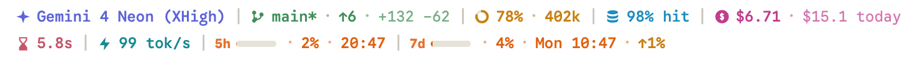

<div align="center">

# AGY Statusline

[简体中文](README.md) | [English](README.en.md)

**Google Antigravity 2.x 桌面端的原生 Rust 状态栏与用量遥测插件（macOS / Windows）**

输入框上方实时状态栏 · 侧边栏用量看板与调用明细 · 8 套明暗主题 · 可选中文界面 · 一键校验自更新

[](https://github.com/BlueOcean223/agy-statusline/releases/latest)
[](LICENSE)


<br>



</div>

> [!NOTE]
> 这是一个第三方开源插件。所有遥测数据均只读获取自本机 `language_server` 与本地文件，**不拦截、不修改任何发往 Google 的请求**。视觉风格参考 [agy-zh-pack](https://github.com/ncdeng/agy-zh-pack) 与 [CCometixLine](https://github.com/Haleclipse/CCometixLine)。

---

## 核心特性

- **原生轻量 Rust Sidecar**：单二进制运行，直接读取本机只读接口并配合 Hooks 即时刷新，**无需 Hook `fetch`、无需刷新窗口即可生效**；内置侧边栏 `"plugin unavailable"` 卡死自动恢复。
- **输入框上方状态栏**：两行展示模型、Git 仓库状态（分支/脏状态/领先落后/增删行数）、上下文占比与压缩徽章、Prompt 缓存命中率与未命中归因、对话/今日折算花费（含 `agy CLI` 合并与可配置单次高价 `⚡` 提醒）、首字延迟、输出速度、5h/7d 额度与节奏，以及树形列对齐的子代理行。
- **五标签页右侧面板（`AUX_PANE`）**：顶部常驻实时状态栏预览，下方提供 **Overview / Turns / Usage / Theme / Settings** 完整视图，支持点击上下文压缩节点查看完整压缩摘要。
- **每日用量看板与历史补算**：7 / 30 / 全部（最长 400 天，>62 天自动按周合并）按模型堆叠柱状图、同步合并桌面端与 `agy CLI` 用量、6 类缓存未命中归因统计、单日「按次调用 / 按对话」下钻（支持来源/模型/未命中筛选与分页），以及按账号隔离的每周额度分段净变化、提早重置标记（`↺`）、按周期起点精算容量（`cap ≈`）与过往周期记录。
- **分层外观定制**：8 套明暗双版配色（`Theme` 页每张卡片均为当前对话的实时预览）、3 种外形、4 种额度进度条、紧凑/完整信息密度与 4 种内联图标样式（不依赖外部图标字体）。
- **可选中文界面**：集成 [agy-zh-pack](https://github.com/ncdeng/agy-zh-pack) 词典与翻译器 v12，支持主窗口与 Swarm 面板同步翻译；打开与关闭均**立刻生效**（关闭即时还原英文，无需刷新窗口），支持 `Ctrl+Option+E`（macOS）/ `Ctrl+Alt+E`（Windows）临时切回英文，报错信息悬停显示英文原文。
- **跨平台重启与更新中心**：支持 macOS / Windows 调试模式重启与防误重启进程校验；内置 GitHub Releases 一键 `SHA256SUMS` 校验自更新，以及可选的词典与官方价格表在线同步。

---

## 快速安装

从 [Releases](https://github.com/BlueOcean223/agy-statusline/releases/latest) 下载对应平台的压缩包，解压出 `agy-statusline/` 文件夹放入 Antigravity 插件目录，Antigravity 会自动加载：

| 平台 | 安装包 | 插件目录 |
|---|---|---|
| **macOS**（Apple Silicon & Intel 通用） | `agy-statusline-v<版本>-macos-universal.tar.gz` | `~/.gemini/config/plugins/agy-statusline` |
| **Windows**（x64） | `agy-statusline-v<版本>-windows-x64.zip` | `%USERPROFILE%\.gemini\config\plugins\agy-statusline` |

> **macOS 提示**：二进制未签名，如通过浏览器下载，请先移除隔离属性：
> ```bash
> xattr -dr com.apple.quarantine ~/.gemini/config/plugins/agy-statusline
> ```

Release 页面附带 `SHA256SUMS` 供校验。装好后在 Antigravity 右上角插件菜单中打开 **Statusline** 即可使用右侧面板；后续有新版本可直接在 `Settings → 更新中心` 一键更新。

---

## 启用输入框状态栏与中文界面

Antigravity 2.33.0 起，需要带 `--remote-debugging-port=0` 启动参数才能向主窗口注入状态栏和中文界面（不带参数时，右侧面板照常工作）。

- **推荐方式**：打开右侧面板 `Settings`，点击 **「以调试模式重启 Antigravity」**（二次确认，支持 macOS 与 Windows），插件会自动退出并带参数重新拉起。
- **可选自动策略**：在 `Settings` 的 **「未带调试端口启动时」** 可切换 `不处理（默认）`、`弹框询问` 或 `自动重开`。触发前会先核验主进程命令行确实缺少参数，避免端口繁忙时误重启。
- **手动启动**：
  ```bash
  # macOS
  open -a Antigravity --args --remote-debugging-port=0
  ```
  ```powershell
  # Windows
  & "$env:LOCALAPPDATA\Programs\antigravity\Antigravity.exe" --remote-debugging-port=0
  ```

`0` 表示分配随机本机端口，sidecar 每 3 秒自动检测并注入，无需刷新窗口。

> [!WARNING]
> 开启 `--remote-debugging-port` 会在本机 `127.0.0.1` 暴露 Chromium 调试端口，本机其他进程可通过该端口访问 Antigravity 窗口。如介意此项，可不启用调试端口，仅使用右侧辅助面板。

---

## 功能一览

### 输入框状态栏

所有段均带自绘悬停提示（不被重绘打断），并在 `Settings` 提供 12 个独立显示开关：

| 区域 | 显示项 | 说明 |
|---|---|---|
| **第一行** | 模型 · Git · 上下文 · 缓存 · 花费 · 运行状态 | 接口实际返回模型与界面名不符时标黄提醒；Git 显示分支/未提交 `*`/领先落后/相对 HEAD 行数变化；上下文配动态圆环仪表与紧凑压缩徽章 `↻N×`；缓存悬停展示近期未命中原因；单次调用超过高价阈值（默认 `$0.50`）显示 `⚡` 徽章，花费悬停同时列出 `agy CLI` 今日花费；`running` 空闲占位防止跳行 |
| **第二行** | 首字延迟 · 输出速度 · `5h` 额度 · `7d` 额度 | 额度提供细条/10 格/圆环/隐藏四种样式；`7d` 附带相对一周匀速进度的超前（`↑` 标黄）或富余（`↓` 标绿）百分点 |
| **子代理行** | `├` / `└` 树形多列对齐 | 自动展示活跃及刚结束（保留 10 秒）的子代理：角色、模型、上下文、缓存、自身花费与状态（`● 实时耗时` / `● waiting` 等待审批 / `✓ done 用时 · 步数`），悬停看当前动作与最近 5 步时间线 |

### 右侧辅助面板（5 个标签页）

| 标签页 | 内容 |
|---|---|
| **Overview** | 当前对话上下文趋势与剩余轮次估算、可点击查看上下文压缩摘要（Checkpoint）、Prompt 缓存命中/热度倒计时/节省金额与未命中归因、Token 与费用明细（含 Claude 缓存写入）、速度/TTFT 折线图、5h & 7d 双条额度进度及子代理跳转列表 |
| **Turns** | 按倒序展示当前对话每次模型调用的时间、上下文大小、命中率与缓存未命中原因标签、高价高亮、输出量、费用、速度、操作摘要，以及可点击查看完整正文的压缩节点 |
| **Usage** | 今日 4 格 KPI（合并桌面端与 `agy CLI`，含缓存未命中浪费估算）、7/30/全部（最长 400 天，>62 天按周合并）堆叠柱状图、每日汇总表、**单日明细下钻**（「按次调用 / 按对话」切换 + 来源/模型/未命中筛选与分页），以及按账号隔离的每周额度分段净变化、提早重置（`↺`）、周期容量（`cap ≈`）与过往周期记录；首次运行自动只读补算历史数据 |
| **Theme** | 8 套明暗双版配色画廊（Cometix / Catppuccin / Tokyo Night / Rosé Pine / Gruvbox / Nord / Dracula / Mono，每张卡片实时渲染当前对话），以及外形（`plain` / `pill` / `powerline`）、额度进度条（`thin` / `cells` / `ring` / `none`）、信息密度（`compact` / `full`）与图标样式（`solid` / `outline` / `unicode` / `off`） |
| **Settings** | 状态栏总开关与 12 个分段开关、中文界面开关与临时切回英文（`Ctrl+Option+E` / `Ctrl+Alt+E`）、高价调用提醒阈值、无调试端口启动策略与重启按钮、**更新中心**（插件自更新 + 词典/价格表在线同步）以及计算口径配置 |

---

## 费用口径、隐私与网络

- **折算费用**：`费用 = token × 公开 API 标准价`，仅用于参考，不代表订阅实际扣费。内置单价覆盖 Gemini 4（含 Carbon/Argon `2026-12-01` 与 3.8 Flash `2027-01-01` 分时调价）、Claude Opus/Sonnet/Haiku（含 5 分钟缓存写入）及常见第三方模型，可在 `config.toml` 的 `[[models]]` 中自定义。
- **本地隐私与数据安全**：仅在 `plugin_data/agy-statusline/` 写入配置、数值汇总、CLI 索引与额度采样，不持久化对话正文或完整邮箱（账号仅存打码邮箱与哈希键）；压缩摘要按需只读本机 `transcript_full.jsonl` 并受面板令牌校验保护；所有落盘文件采用原子写入并在解析失败时自动备份为 `.bad-*`，避免历史数据被意外覆盖。
- **联网行为**：默认仅两类只读下载（均可在 `Settings → 更新中心` 关闭，自动适配环境变量与 macOS/Windows 系统代理）：
  1. 检查/下载本仓库 GitHub Releases 安装包与 `SHA256SUMS`（仅在手动点击更新后安装，开发仓库含 `.git` 时禁止覆盖）；
  2. 按最新 commit SHA 从 `ncdeng/agy-zh-pack`（jsDelivr 多镜像 + GitHub raw 回退）同步词典、规则与官方价格表。

---

## 开发与文档

- 架构原理、数据源、本地构建与发版流程：[docs/development.md](docs/development.md)
- 方案对比与数据流图解：[docs/architecture.html](docs/architecture.html)

---

## 致谢与许可

- 状态栏视觉设计、配色思路与中文词典/翻译器来自或参考 [agy-zh-pack](https://github.com/ncdeng/agy-zh-pack) 与 [CCometixLine](https://github.com/Haleclipse/CCometixLine)。
- 配色色值取自 Catppuccin、Tokyo Night、Rosé Pine、Gruvbox、Nord 与 Dracula 公开规范。
- 本项目采用 **MIT** 许可，见 [LICENSE](LICENSE)。`i18n/` 下的词典与翻译脚本沿用 agy-zh-pack 的 MIT 许可（[i18n/LICENSE](i18n/LICENSE)）。`web/preload.js` 为 Antigravity 自带的 sidecar 桥接脚本，不在本项目许可范围内。
